# 📚 우리 서재 & 수업 도서 갤러리

> **구조**: `books/` (도서 카드) · `covers/` (표지 이미지) · `Inbox.md` (빠른 감상 메모) · `목록.html` (검색·필터 화면)  
> **총 보유 도서**: 164권 (🎨 그림책: 59권 / 📖 일반 도서: 105권)

👉 **[🔍 대화형 검색 및 필터 웹 화면 열기 (목록.html)](목록.html)**

---

## 🎨 그림책 목록 (59권)
| 번호 | 표지 | 서명 / 정보 | 연계 교과 | 주요 주제 | 수업 PPTX |
|:---:|:---:|---|:---:|---|:---:|
| 1 | [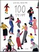](covers/100 인생 그림책.jpg) | **[100 인생 그림책](books/100 인생 그림책.md)** 하이케 팔러 · 사계절 | 국어, 도덕 | 자아/관계, 가치 탐색 | `3학년/100 인생 그림책.pptx` |
| 2 | [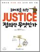](covers/10대를 위한 JUSTICE 정의란 무엇인가.jpg) | **[10대를 위한 JUSTICE 정의란 무엇인가](books/10대를 위한 JUSTICE 정의란 무엇인가.md)** 마이클 샌델 원저 · 미래엔아이세움 | 국어, 도덕 | 자아/관계, 가치 탐색 | `3학년/10대를 위한 JUSTICE 정의란 무엇인가.pptx` |
| 3 | [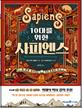](covers/10대를 위한 사피엔스.jpg) | **[10대를 위한 사피엔스](books/10대를 위한 사피엔스.md)** 벵트 에릭 엥홀름 · 미래엔아이세움 | 국어, 도덕 | 자아/관계, 가치 탐색 | `3학년/10대를 위한 사피엔스.pptx` |
| 4 |  | **[감기 걸린 물고기](books/감기 걸린 물고기.md)** 박정섭 · 사계절 | 국어, 도덕 | 자아/관계, 가치 탐색 | `3학년/감기 걸린 물고기.pptx` |
| 5 | [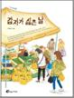](covers/감자가 싫은 날.jpg) | **[감자가 싫은 날](books/감자가 싫은 날.md)** 지혜진 · 바람의아이들 | 국어, 도덕 | 자아/관계, 가치 탐색 | `3학년/감자가 싫은 날.pptx` |
| 6 | [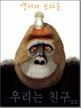](covers/고릴라 가족.jpg) | **[고릴라 가족](books/고릴라 가족.md)** 앤서니 브라운 · 웅진주니어 | 국어, 도덕 | 자아/관계, 가치 탐색 | `3학년/고릴라 가족.pptx` |
| 7 | [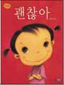](covers/괜찮아.jpg) | **[괜찮아](books/괜찮아.md)** 최숙희 · 웅진주니어 | 국어, 도덕 | 자아/관계, 가치 탐색 | `3학년/괜찮아.pptx` |
| 8 | [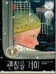](covers/괜찮을 거야.jpg) | **[괜찮을 거야](books/괜찮을 거야.md)** 시드니 스미스 · 책읽는곰 | 국어, 도덕 | 자아/관계, 가치 탐색 | `3학년/괜찮을 거야.pptx` |
| 9 | [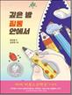](covers/깊은 밤 필통 안에서.jpg) | **[깊은 밤 필통 안에서](books/깊은 밤 필통 안에서.md)** 길상효 · 비룡소 | 국어, 도덕 | 자아/관계, 가치 탐색 | `3학년/깊은 밤 필통 안에서.pptx` |
| 10 | [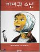](covers/까마귀 소년.jpg) | **[까마귀 소년](books/까마귀 소년.md)** 야시마 타로 · 비룡소 | 국어, 도덕 | 자아/관계, 가치 탐색 | `3학년/까마귀 소년.pptx` |
| 11 | [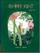](covers/꼭두새벽을 보았니.jpg) | **[꼭두새벽을 보았니](books/꼭두새벽을 보았니.md)** 안 에르보 · 한울림어린이 | 국어, 도덕 | 자아/관계, 가치 탐색 | `3학년/꼭두새벽을 보았니.pptx` |
| 12 | [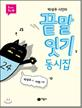](covers/끝말잇기 동시집.jpg) | **[끝말잇기 동시집](books/끝말잇기 동시집.md)** 박성우 · 비룡소 | 국어, 도덕 | 자아/관계, 가치 탐색 | `3학년/끝말잇기 동시집.pptx` |
| 13 | [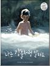](covers/나는 강물처럼 말해요.jpg) | **[나는 강물처럼 말해요](books/나는 강물처럼 말해요.md)** 조던 스콧 · 책읽는곰 | 국어, 도덕 | 자아/관계, 가치 탐색 | `3학년/나는 강물처럼 말해요.pptx` |
| 14 | [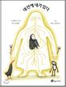](covers/내 안에 내가 있다.jpg) | **[내 안에 내가 있다](books/내 안에 내가 있다.md)** 알렉스 쿠소 · 바람의아이들 | 국어, 도덕 | 자아/관계, 가치 탐색 | `3학년/내 안에 내가 있다.pptx` |
| 15 | [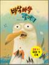](covers/네 기분은 어떤 색깔이니.jpg) | **[네 기분은 어떤 색깔이니](books/네 기분은 어떤 색깔이니.md)** 최숙희 · 책읽는곰 | 국어, 도덕 | 자아/관계, 가치 탐색 | `3학년/네 기분은 어떤 색깔이니.pptx` |
| 16 | [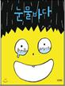](covers/눈물바다.jpg) | **[눈물바다](books/눈물바다.md)** 서현 · 사계절 | 국어, 도덕 | 자아/관계, 가치 탐색 | `3학년/눈물바다.pptx` |
| 17 | [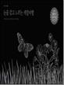](covers/눈을 감고 느끼는 색깔여행.jpg) | **[눈을 감고 느끼는 색깔여행](books/눈을 감고 느끼는 색깔여행.md)** 메네나 코틴 · 고래이야기 | 국어, 도덕 | 자아/관계, 가치 탐색 | `3학년/눈을 감고 느끼는 색깔여행.pptx` |
| 18 | [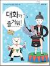](covers/대화가 즐거워!.jpg) | **[대화가 즐거워!](books/대화가 즐거워!.md)** 김민화 · 해와나무 | 국어, 도덕 | 자아/관계, 가치 탐색 | `3학년/대화가 즐거워!.pptx` |
| 19 | [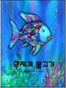](covers/무지개 물고기.jpg) | **[무지개 물고기](books/무지개 물고기.md)** 마르쿠스 피스터 · 시공주니어 | 국어, 도덕 | 자아/관계, 가치 탐색 | `3학년/무지개 물고기.pptx` |
| 20 | [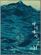](covers/바다에서 M.jpg) | **[바다에서 M](books/바다에서 M.md)** 요안나 콘세이요 · 사계절 | 국어, 도덕 | 자아/관계, 가치 탐색 | `3학년/바다에서 M.pptx` |
| 21 | [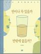](covers/반이나 차 있을까 반밖에 없을까.jpg) | **[반이나 차 있을까 반밖에 없을까](books/반이나 차 있을까 반밖에 없을까.md)** 이보나 흐미엘레프스카 · 논장 | 국어, 도덕 | 자아/관계, 가치 탐색 | `3학년/반이나 차 있을까 반밖에 없을까.pptx` |
| 22 | [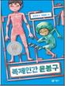](covers/복제인간 윤봉구.jpg) | **[복제인간 윤봉구](books/복제인간 윤봉구.md)** 임은하 · 비룡소 | 국어, 도덕 | 자아/관계, 가치 탐색 | `3학년/복제인간 윤봉구.pptx` |
| 23 | [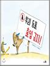](covers/부리 동물 출입 금지!.jpg) | **[부리 동물 출입 금지!](books/부리 동물 출입 금지!.md)** 소피 레스코 · 천개의바람 | 국어, 도덕 | 자아/관계, 가치 탐색 | `3학년/부리 동물 출입 금지!.pptx` |
| 24 | [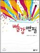](covers/빨강 연필.jpg) | **[빨강 연필](books/빨강 연필.md)** 신수현 · 비룡소 | 국어, 도덕 | 자아/관계, 가치 탐색 | `3학년/빨강 연필.pptx` |
| 25 | [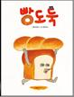](covers/빵도둑.jpg) | **[빵도둑](books/빵도둑.md)** 시바타 게이코 · 길벗어린이 | 국어, 도덕 | 자아/관계, 가치 탐색 | `3학년/빵도둑.pptx` |
| 26 | [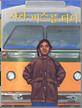](covers/사라, 버스를 타다.jpg) | **[사라, 버스를 타다](books/사라, 버스를 타다.md)** 윌리엄 밀러 · 사계절 | 국어, 도덕 | 자아/관계, 가치 탐색 | `3학년/사라, 버스를 타다.pptx` |
| 27 | [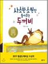](covers/사소한 소원만 들어주는 두꺼비.jpg) | **[사소한 소원만 들어주는 두꺼비](books/사소한 소원만 들어주는 두꺼비.md)** 전금자 · 비룡소 | 국어, 도덕 | 자아/관계, 가치 탐색 | `3학년/사소한 소원만 들어주는 두꺼비.pptx` |
| 28 | [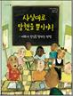](covers/사실대로 말했을 뿐이야!.jpg) | **[사실대로 말했을 뿐이야!](books/사실대로 말했을 뿐이야!.md)** 패트리샤 맥키삭 · 고래이야기 | 국어, 도덕 | 자아/관계, 가치 탐색 | `3학년/사실대로 말했을 뿐이야!.pptx` |
| 29 | [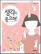](covers/생각이 중요해!.jpg) | **[생각이 중요해!](books/생각이 중요해!.md)** 김민화 · 해와나무 | 국어, 도덕 | 자아/관계, 가치 탐색 | `3학년/생각이 중요해!.pptx` |
| 30 | [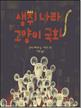](covers/생쥐 나라 고양이 국회.jpg) | **[생쥐 나라 고양이 국회](books/생쥐 나라 고양이 국회.md)** 알리스 메리쿠르 · 책읽는곰 | 국어, 도덕 | 자아/관계, 가치 탐색 | `3학년/생쥐 나라 고양이 국회.pptx` |
| 31 | [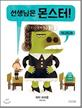](covers/선생님은 몬스터!.jpg) | **[선생님은 몬스터!](books/선생님은 몬스터!.md)** 피터 브라운 · 사계절 | 국어, 도덕 | 자아/관계, 가치 탐색 | `3학년/선생님은 몬스터!.pptx` |
| 32 | [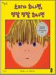](covers/소피가 화나면 정말 정말 화나면.jpg) | **[소피가 화나면 정말 정말 화나면](books/소피가 화나면 정말 정말 화나면.md)** 몰리 뱅 · 책읽는곰 | 국어, 도덕 | 자아/관계, 가치 탐색 | `3학년/소피가 화나면 정말 정말 화나면.pptx` |
| 33 | [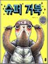](covers/슈퍼 거북.jpg) | **[슈퍼 거북](books/슈퍼 거북.md)** 유설화 · 책읽는곰 | 국어, 도덕 | 자아/관계, 가치 탐색 | `3학년/슈퍼 거북.pptx` |
| 34 | [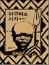](covers/야쿠바와 사자 1.jpg) | **[야쿠바와 사자 1](books/야쿠바와 사자 1.md)** 티에리 드되 · 길벗어린이 | 국어, 도덕 | 자아/관계, 가치 탐색 | `3학년/야쿠바와 사자 1.pptx` |
| 35 | [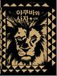](covers/야쿠바와 사자 2.jpg) | **[야쿠바와 사자 2](books/야쿠바와 사자 2.md)** 티에리 드되 · 길벗어린이 | 국어, 도덕 | 자아/관계, 가치 탐색 | `3학년/야쿠바와 사자 2.pptx` |
| 36 | [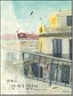](covers/언제나 난 여기 있단다.jpg) | **[언제나 난 여기 있단다](books/언제나 난 여기 있단다.md)** 안 에르보 · 한울림어린이 | 국어, 도덕 | 자아/관계, 가치 탐색 | `3학년/언제나 난 여기 있단다.pptx` |
| 37 | [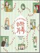](covers/우리는 가족.jpg) | **[우리는 가족](books/우리는 가족.md)** 마리아나 페레스 · 키다리 | 국어, 도덕 | 자아/관계, 가치 탐색 | `3학년/우리는 가족.pptx` |
| 38 | [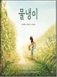](covers/우리는 친구.jpg) | **[우리는 친구](books/우리는 친구.md)** 앤서니 브라운 · 웅진주니어 | 국어, 도덕 | 자아/관계, 가치 탐색 | `3학년/우리는 친구.pptx` |
| 39 | [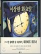](covers/이상한 화요일.jpg) | **[이상한 화요일](books/이상한 화요일.md)** 데이비드 위스너 · 비룡소 | 국어, 도덕 | 자아/관계, 가치 탐색 | `3학년/이상한 화요일.pptx` |
| 40 | [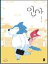](covers/인사.jpg) | **[인사](books/인사.md)** 김성미 · 책읽는곰 | 국어, 도덕 | 자아/관계, 가치 탐색 | `3학년/인사.pptx` |
| 41 | [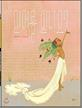](covers/인어를 믿나요.jpg) | **[인어를 믿나요](books/인어를 믿나요.md)** 제시카 러브 · 웅진주니어 | 국어, 도덕 | 자아/관계, 가치 탐색 | `3학년/인어를 믿나요.pptx` |
| 42 | [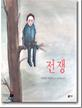](covers/전쟁.jpg) | **[전쟁](books/전쟁.md)** 아나이스 보즐라 · 비룡소 | 국어, 도덕 | 자아/관계, 가치 탐색 | `3학년/전쟁.pptx` |
| 43 | [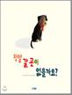](covers/정말 갈 곳이 없을까요.jpg) | **[정말 갈 곳이 없을까요](books/정말 갈 곳이 없을까요.md)** 리처드 존스 · 웅진주니어 | 국어, 도덕 | 자아/관계, 가치 탐색 | `3학년/정말 갈 곳이 없을까요.pptx` |
| 44 | [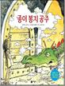](covers/종이 봉지 공주.jpg) | **[종이 봉지 공주](books/종이 봉지 공주.md)** 로버트 문치 · 비룡소 | 국어, 도덕 | 자아/관계, 가치 탐색 | `3학년/종이 봉지 공주.pptx` |
| 45 | [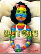](covers/줄무늬가 생겼어요.jpg) | **[줄무늬가 생겼어요](books/줄무늬가 생겼어요.md)** 조세현 · 비룡소 | 국어, 도덕 | 자아/관계, 가치 탐색 | `3학년/줄무늬가 생겼어요.pptx` |
| 46 | [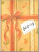](covers/중요한 사실.jpg) | **[중요한 사실](books/중요한 사실.md)** 마거릿 와이즈 브라운 · 보림 | 국어, 도덕 | 자아/관계, 가치 탐색 | `3학년/중요한 사실.pptx` |
| 47 | [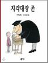](covers/지각대장 존.jpg) | **[지각대장 존](books/지각대장 존.md)** 존 버닝햄 · 비룡소 | 국어, 도덕 | 자아/관계, 가치 탐색 | `3학년/지각대장 존.pptx` |
| 48 | [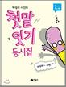](covers/첫말 잇기 동시집.jpg) | **[첫말 잇기 동시집](books/첫말 잇기 동시집.md)** 박성우 · 비룡소 | 국어, 도덕 | 자아/관계, 가치 탐색 | `3학년/첫말 잇기 동시집.pptx` |
| 49 | [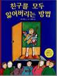](covers/친구를 모두 잃어버리는 방법.jpg) | **[친구를 모두 잃어버리는 방법](books/친구를 모두 잃어버리는 방법.md)** 신형건 · 보물창고 | 국어, 도덕 | 자아/관계, 가치 탐색 | `3학년/친구를 모두 잃어버리는 방법.pptx` |
| 50 | [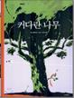](covers/커다란 나무.jpg) | **[커다란 나무](books/커다란 나무.md)** 나선희 · 시공주니어 | 국어, 도덕 | 자아/관계, 가치 탐색 | `3학년/커다란 나무.pptx` |
| 51 | [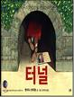](covers/터널.jpg) | **[터널](books/터널.md)** 앤서니 브라운 · 논장 | 국어, 도덕 | 자아/관계, 가치 탐색 | `3학년/터널.pptx` |
| 52 |  | **[프레드릭](books/프레드릭.md)** 레오 리오니 · 시공주니어 | 국어, 도덕 | 일과 예술, 비판적 읽기 | `3학년/프레드릭.pptx` |
| 53 |  | **[프린들 주세요](books/프린들 주세요.md)** 앤드루 클레먼츠 · 사계절 | 국어, 도덕 | 자아/관계, 가치 탐색 | `3학년/프린들 주세요.pptx` |
| 54 |  | **[플라스틱이 온다](books/플라스틱이 온다.md)** 빅토리아 퍼즈 · 한울림어린이 | 국어, 도덕 | 자아/관계, 가치 탐색 | `3학년/플라스틱이 온다.pptx` |
| 55 |  | **[한밤중 달빛 식당](books/한밤중 달빛 식당.md)** 이분희 · 비룡소 | 국어, 도덕 | 자아/관계, 가치 탐색 | `3학년/한밤중 달빛 식당.pptx` |
| 56 |  | **[한양 1770년](books/한양 1770년.md)** 정승모 · 보림 | 국어, 도덕 | 자아/관계, 가치 탐색 | `3학년/한양 1770년.pptx` |
| 57 |  | **[핫 도그](books/핫 도그.md)** 더그 살라티 · 보물창고 | 국어, 도덕 | 자아/관계, 가치 탐색 | `3학년/핫 도그.pptx` |
| 58 |  | **[행동은 멋지게!](books/행동은 멋지게!.md)** 김민화 · 해와나무 | 국어, 도덕 | 자아/관계, 가치 탐색 | `3학년/행동은 멋지게!.pptx` |
| 59 |  | **[행복한 사자](books/행복한 사자.md)** 로저 뒤바젱 · 시공주니어 | 국어, 도덕 | 자아/관계, 가치 탐색 | `3학년/행복한 사자.pptx` |

---

## 📖 일반 도서 목록 (105권)
| 번호 | 표지 | 서명 / 정보 | 연계 교과 | 주요 주제 | 비고 |
|:---:|:---:|---|:---:|---|:---:|
| 1 |  | **[1등 없는 1등](books/1등 없는 1등.md)** 실비아 태케마 · 아름다운사람들 | 국어 | 인문/교양 | - |
| 2 |  | **[30번 곰](books/30번 곰.md)** 지경애 · 다림 | 국어 | 인문/교양 | - |
| 3 |  | **[4998 친구](books/4998 친구.md)** 다비드 칼리(코르넬리우스) · 책빛 | 국어 | 인문/교양 | - |
| 4 |  | **[5번 레인](books/5번 레인.md)** 은소홀 · 문학동네 | 국어 | 인문/교양 | - |
| 5 |  | **[간다아아!](books/간다아아!.md)** 코리 R 테이버 · 오늘책 | 국어 | 인문/교양 | - |
| 6 |  | **[거인의 정원](books/거인의 정원.md)** 오스카 와일드 · 베틀북 | 국어 | 인문/교양 | - |
| 7 |  | **[걱정 덜어내는 책](books/걱정 덜어내는 책.md)** 레이첼 브라이언 · 아울북 | 국어 | 인문/교양 | - |
| 8 |  | **[경제의 핏줄 화폐](books/경제의 핏줄 화폐.md)** 김성호 · 미래아이(미래M&B) | 국어 | 인문/교양 | - |
| 9 |  | **[고양이 탐정 윈스턴 열두 살 여자아이가 되다](books/고양이 탐정 윈스턴 열두 살 여자아이가 되다.md)** 프라우케 쇼이네만 · 크레용하우스 | 국어 | 인문/교양 | - |
| 10 |  | **[고요한 나라를 찾아서](books/고요한 나라를 찾아서.md)** 문지나 · 북극곰 | 국어 | 인문/교양 | - |
| 11 |  | **[곰돌이 팬티](books/곰돌이 팬티.md)** 김미대 · 북극곰 | 국어 | 인문/교양 | - |
| 12 |  | **[곰아, 놀자!](books/곰아, 놀자!.md)** 조리 존 · 북극곰 | 국어 | 인문/교양 | - |
| 13 |  | **[긴긴밤](books/긴긴밤.md)** 루리 · 문학동네 | 국어 | 인문/교양 | - |
| 14 |  | **[꼬꼬야 울지마! 왕따 마영포 1](books/꼬꼬야 울지마! 왕따 마영포 1.md)** 이석선 · 생각나눔 | 국어 | 인문/교양 | - |
| 15 |  | **[꼬꼬야 울지마! 왕따 마영포 2](books/꼬꼬야 울지마! 왕따 마영포 2.md)** 이석선 · 생각나눔 | 국어 | 인문/교양 | - |
| 16 |  | **[나 진짜 궁금해!](books/나 진짜 궁금해!.md)** 미카 아처 · 나무의말 | 국어 | 인문/교양 | - |
| 17 |  | **[나는 개구리다](books/나는 개구리다.md)** 표영민 · 월천상회 | 국어 | 인문/교양 | - |
| 18 |  | **[나는 매일 생각해](books/나는 매일 생각해.md)** 소피아 힐 · 상수리 | 국어 | 인문/교양 | - |
| 19 |  | **[나보다 멋진 새 있어](books/나보다 멋진 새 있어.md)** 매리언 튜카스 · 국민서관 | 국어 | 인문/교양 | - |
| 20 |  | **[나의 엄마](books/나의 엄마.md)** 강경수 · 그림책공작소 | 국어 | 인문/교양 | - |
| 21 |  | **[낱말 공장 나라](books/낱말 공장 나라.md)** 아네스드 레스트라드 · 세용 | 국어 | 인문/교양 | - |
| 22 |  | **[내 가족과 다른 가족들](books/내 가족과 다른 가족들.md)** 베라 티멘칙 · 꼬마이실 | 국어 | 인문/교양 | - |
| 23 |  | **[너는 특별하단다](books/너는 특별하단다.md)** 맥스 루케이도 · 고슴도치 | 국어 | 인문/교양 | - |
| 24 |  | **[너는 특별하단다 2](books/너는 특별하단다 2.md)** 맥스 루케이도 · 고슴도치 | 국어 | 인문/교양 | - |
| 25 |  | **[너는 특별하단다 3](books/너는 특별하단다 3.md)** 맥스 루케이도 · 고슴도치 | 국어 | 인문/교양 | - |
| 26 |  | **[너는 특별하단다 4](books/너는 특별하단다 4.md)** 맥스 루케이도 · 고슴도치 | 국어 | 인문/교양 | - |
| 27 |  | **[늑대 뛰어넘기](books/늑대 뛰어넘기.md)** 데이비드 허친스 · 바다출판사 | 국어 | 인문/교양 | - |
| 28 |  | **[단어 수집가](books/단어 수집가.md)** 피터 H. 레이놀즈 · 문학동네 | 국어 | 인문/교양 | - |
| 29 |  | **[단톡방 가족](books/단톡방 가족.md)** 제성은 · 마주별 | 국어 | 인문/교양 | - |
| 30 |  | **[담임 선생님은 AI](books/담임 선생님은 AI.md)** 이경화 · 창비 | 국어 | 인문/교양 | - |
| 31 |  | **[더 이상 못 참아!](books/더 이상 못 참아!.md)** 허은실 · 소담주니어 | 국어 | 인문/교양 | - |
| 32 |  | **[돌멩이국](books/돌멩이국.md)** 존 J. 무스 · 달리 | 국어 | 인문/교양 | - |
| 33 |  | **[동동이와 원더마우스](books/동동이와 원더마우스.md)** 조승혜 · 북극곰 | 국어 | 인문/교양 | - |
| 34 |  | **[동의](books/동의.md)** 레이첼 브라이언 · 아울북 | 국어 | 인문/교양 | - |
| 35 |  | **[디어 에번 핸슨](books/디어 에번 핸슨.md)** 밸 에미치, 스티븐 레번슨, 벤지 파섹, · 현대문학 | 국어 | 인문/교양 | - |
| 36 |  | **[루빈스타인은 참 예뻐요](books/루빈스타인은 참 예뻐요.md)** 이순영 · 북극곰 | 국어 | 인문/교양 | - |
| 37 |  | **[마법의 설탕 두 조각](books/마법의 설탕 두 조각.md)** 미하엘 엔데 · 소년한길 | 국어 | 인문/교양 | - |
| 38 |  | **[말들이 사는 나라](books/말들이 사는 나라.md)** 윤여림 · 위즈덤하우스 | 국어 | 인문/교양 | - |
| 39 |  | **[말힘·글힘을 살리는 고사성어](books/말힘·글힘을 살리는 고사성어.md)** 장연 · 고려원북스 | 국어 | 인문/교양 | - |
| 40 |  | **[맛있는 숲의 레몬](books/맛있는 숲의 레몬.md)** 사토 메구미 · 올리 | 국어 | 인문/교양 | - |
| 41 |  | **[멸치 대왕의 꿈](books/멸치 대왕의 꿈.md)** 이월 · 키즈엠 | 국어 | 인문/교양 | - |
| 42 | [.jpg)](covers/명랑한국사 28 무신의 시대 (고려-무신정변).jpg) | **[명랑한국사 28 무신의 시대 (고려-무신정변)](books/명랑한국사 28 무신의 시대 (고려-무신정변).md)** 박서영 · ㈜이수미디어 | 국어 | 인문/교양 | - |
| 43 |  | **[모두를 위한 집](books/모두를 위한 집.md)** 티보 라싸 · 원더박스 | 국어 | 인문/교양 | - |
| 44 |  | **[몽실 언니](books/몽실 언니.md)** 권정생 · 창비 | 국어 | 인문/교양 | - |
| 45 |  | **[물 한 방울](books/물 한 방울.md)** 월터 윅 · 소년한길 | 국어 | 인문/교양 | - |
| 46 |  | **[물냉이](books/물냉이.md)** 안드레아 왕 · 다산기획 | 국어 | 인문/교양 | - |
| 47 |  | **[민들레는 민들레](books/민들레는 민들레.md)** 김장성 · 이야기꽃 | 국어 | 인문/교양 | - |
| 48 |  | **[바삭바삭 갈매기](books/바삭바삭 갈매기.md)** 전민걸 · 한림출판사 | 국어 | 인문/교양 | - |
| 49 |  | **[방학 탐구 생활](books/방학 탐구 생활.md)** 김선정 · 문학동네 | 국어 | 인문/교양 | - |
| 50 |  | **[불량한 자전거 여행](books/불량한 자전거 여행.md)** 김남중 · 창비 | 국어 | 인문/교양 | - |
| 51 |  | **[블랙 독](books/블랙 독.md)** 레비 핀폴드 · 북스토리아이 | 국어 | 인문/교양 | - |
| 52 |  | **[빨간 벽](books/빨간 벽.md)** 브리타 테켄트럽 · 봄봄출판사 | 국어 | 인문/교양 | - |
| 53 |  | **[선생님 사용 설명서](books/선생님 사용 설명서.md)** 차승민 · 고래가숨쉬는도서관 | 국어 | 인문/교양 | - |
| 54 |  | **[세금 내는 아이들](books/세금 내는 아이들.md)** 옥효진 · 한경키즈(한국경제신문) | 국어 | 인문/교양 | - |
| 55 |  | **[소년과 새와 관 짜는 노인](books/소년과 새와 관 짜는 노인.md)** 마틸다 우즈 · 양철북 | 국어 | 인문/교양 | - |
| 56 |  | **[소피아의 화를 푸는 방법](books/소피아의 화를 푸는 방법.md)** 제인 넬슨 · 교실어린이(교육과실천) | 국어 | 인문/교양 | - |
| 57 |  | **[순리](books/순리.md)** 우명 · 참출판사 | 국어 | 인문/교양 | - |
| 58 |  | **[숨 쉬는 도시 꾸리찌바](books/숨 쉬는 도시 꾸리찌바.md)** 안순혜 · 파란자전거 | 국어 | 인문/교양 | - |
| 59 |  | **[숲 속으로](books/숲 속으로.md)** 앤서니 브라운 · 베틀북 | 국어 | 인문/교양 | - |
| 60 |  | **[스갱 아저씨의 염소](books/스갱 아저씨의 염소.md)** 알퐁스 도데 · 북비 | 국어 | 인문/교양 | - |
| 61 |  | **[아나톨의 작은 냄비](books/아나톨의 작은 냄비.md)** 이자벨 카리에 · 씨드북 | 국어 | 인문/교양 | - |
| 62 |  | **[아름다운 실수](books/아름다운 실수.md)** 코리나 루켄 · 나는별 | 국어 | 인문/교양 | - |
| 63 |  | **[아홉 살 마음 사전](books/아홉 살 마음 사전.md)** 박성우 · 창비 | 국어 | 인문/교양 | - |
| 64 |  | **[아홉살 인생](books/아홉살 인생.md)** 위기철 · 청년사 | 국어 | 인문/교양 | - |
| 65 |  | **[안 돼!](books/안 돼!.md)** 마르타 알테스 · 북극곰 | 국어 | 인문/교양 | - |
| 66 |  | **[안 돼, 데이빗!](books/안 돼, 데이빗!.md)** 데이비드 섀넌 · 지경사 | 국어 | 인문/교양 | - |
| 67 |  | **[어느 개 이야기](books/어느 개 이야기.md)** 가브리엘 뱅상 · 별천지 | 국어 | 인문/교양 | - |
| 68 |  | **[어떻게 못됐으면서 착해요](books/어떻게 못됐으면서 착해요.md)** 올리비에 클레르 · 공존 | 국어 | 인문/교양 | - |
| 69 |  | **[어린이 동몽선습](books/어린이 동몽선습.md)** 김영이 엮음 · 한국독서지도회 | 국어 | 인문/교양 | - |
| 70 |  | **[어린이 명심보감](books/어린이 명심보감.md)** 김종상 엮음 · 한국독서지도회 | 국어 | 인문/교양 | - |
| 71 |  | **[어린이 사자소학](books/어린이 사자소학.md)** 엄기원 엮음 · 한국독서지도회 | 국어 | 인문/교양 | - |
| 72 |  | **[엄마를 화나게 하는 10가지 방법](books/엄마를 화나게 하는 10가지 방법.md)** 실비 드 마튀이시왹스 · 어린이작가정신 | 국어 | 인문/교양 | - |
| 73 |  | **[열두 달 한뼘 텃밭](books/열두 달 한뼘 텃밭.md)** 느림 · 보리 | 국어 | 인문/교양 | - |
| 74 |  | **[열두 살에 부자가 된 키라](books/열두 살에 부자가 된 키라.md)** 보도 섀퍼 · 을파소(21세기북스) | 국어 | 인문/교양 | - |
| 75 |  | **[영웅을 찾습니다!](books/영웅을 찾습니다!.md)** 차이자오룬 · 키위북스(아동) | 국어 | 인문/교양 | - |
| 76 |  | **[올바름을 찾아가는 슬기로운 생활](books/올바름을 찾아가는 슬기로운 생활.md)** 이종란 · 자음과모음 | 국어 | 인문/교양 | - |
| 77 |  | **[워터 프로텍터](books/워터 프로텍터.md)** 캐롤 린드스트롬 · 오늘책 | 국어 | 인문/교양 | - |
| 78 |  | **[원자에서 우주까지 과학 수업 시간입니다](books/원자에서 우주까지 과학 수업 시간입니다.md)** 마이크 바필드 · 풀과바람 | 국어 | 인문/교양 | - |
| 79 |  | **[위니를 찾아서](books/위니를 찾아서.md)** 린지 매틱 · 미디어창비 | 국어 | 인문/교양 | - |
| 80 |  | **[이렇게 말이야](books/이렇게 말이야.md)** 클레르 르부르 · 책빛 | 국어 | 인문/교양 | - |
| 81 |  | **[인권, 교문을 넘다](books/인권, 교문을 넘다.md)** 배경내 · 한겨레에듀 | 국어 | 인문/교양 | - |
| 82 |  | **[읽으면서 바로 써먹는 어린이 속담](books/읽으면서 바로 써먹는 어린이 속담.md)** 한날 · 파란정원 | 국어 | 인문/교양 | - |
| 83 |  | **[잃어버린 겨울 방학](books/잃어버린 겨울 방학.md)** 이소완 · 봄볕 | 국어 | 인문/교양 | - |
| 84 |  | **[장갑보다 따뜻하네](books/장갑보다 따뜻하네.md)** 이모토 요코 · 북극곰 | 국어 | 인문/교양 | - |
| 85 |  | **[절대로 실수하지 않는 아이](books/절대로 실수하지 않는 아이.md)** 마크 펫, 게리 루빈스타인 · 두레아이들 | 국어 | 인문/교양 | - |
| 86 |  | **[점](books/점.md)** 피터 H. 레이놀즈 · 문학동네 | 국어 | 인문/교양 | - |
| 87 |  | **[존중, 누구에게나 당연한 걸까](books/존중, 누구에게나 당연한 걸까.md)** 김민화 · 다림 | 국어 | 인문/교양 | - |
| 88 |  | **[죽기 전에 봐야 할 사후 세계 설명서](books/죽기 전에 봐야 할 사후 세계 설명서.md)** 하시즈메 다이사부로 · 불광출판사 | 국어 | 인문/교양 | - |
| 89 |  | **[지각 중계석](books/지각 중계석.md)** 김현욱 · 문학동네 | 국어 | 인문/교양 | - |
| 90 |  | **[지혜가 열리는 한국사](books/지혜가 열리는 한국사.md)** 옥재원 · 틈새책방 | 국어 | 인문/교양 | - |
| 91 |  | **[진정한 일곱 살](books/진정한 일곱 살.md)** 허은미 · 만만한책방 | 국어 | 인문/교양 | - |
| 92 |  | **[차이나 핸드북](books/차이나 핸드북.md)** 성균중국연구소 편 · 김영사 | 국어 | 인문/교양 | - |
| 93 |  | **[참말인지 거짓말인지 어떻게 알아요](books/참말인지 거짓말인지 어떻게 알아요.md)** 올리비에 클레르 · 공존 | 국어 | 인문/교양 | - |
| 94 |  | **[철수는 철수다](books/철수는 철수다.md)** 노경실 · 크레용하우스 | 국어 | 인문/교양 | - |
| 95 |  | **[탁탁 톡톡 음매~ 젖소가 편지를 쓴대요](books/탁탁 톡톡 음매~ 젖소가 편지를 쓴대요.md)** 도린 크로닌 · 주니어RHK | 국어 | 인문/교양 | - |
| 96 |  | **[토론이 좋아요](books/토론이 좋아요.md)** 김정순, 이영근 · 에듀니티 | 국어 | 인문/교양 | - |
| 97 |  | **[트루먼 스쿨 악플 사건](books/트루먼 스쿨 악플 사건.md)** 도리 힐레스타드 버틀러 · 미래인 | 국어 | 인문/교양 | - |
| 98 |  | **[틀려도 괜찮아](books/틀려도 괜찮아.md)** 마키타 신지 · 토토북 | 국어 | 인문/교양 | - |
| 99 |  | **[푸른 사자 와니니 2](books/푸른 사자 와니니 2.md)** 이현 · 창비 | 국어 | 인문/교양 | - |
| 100 |  | **[플라스틱 섬](books/플라스틱 섬.md)** 이명애 · 상출판사 | 국어 | 인문/교양 | - |
| 101 |  | **[플레이 볼](books/플레이 볼.md)** 이현 · 한겨레아이들 | 국어 | 인문/교양 | - |
| 102 |  | **[할머니와 나의 이어달리기](books/할머니와 나의 이어달리기.md)** 이선주 · 우리학교 | 국어 | 인문/교양 | - |
| 103 |  | **[혼자 가야 해](books/혼자 가야 해.md)** 조원희 · 느림보 | 국어 | 인문/교양 | - |
| 104 |  | **[흔한남매 불꽃 튀는 우리말 2](books/흔한남매 불꽃 튀는 우리말 2.md)** 흔한남매 원저 · 다산어린이 | 국어 | 인문/교양 | - |
| 105 |  | **[힐러 아이나](books/힐러 아이나.md)** 김수영 · 꿈꾸는지구 | 국어 | 인문/교양 | - |
